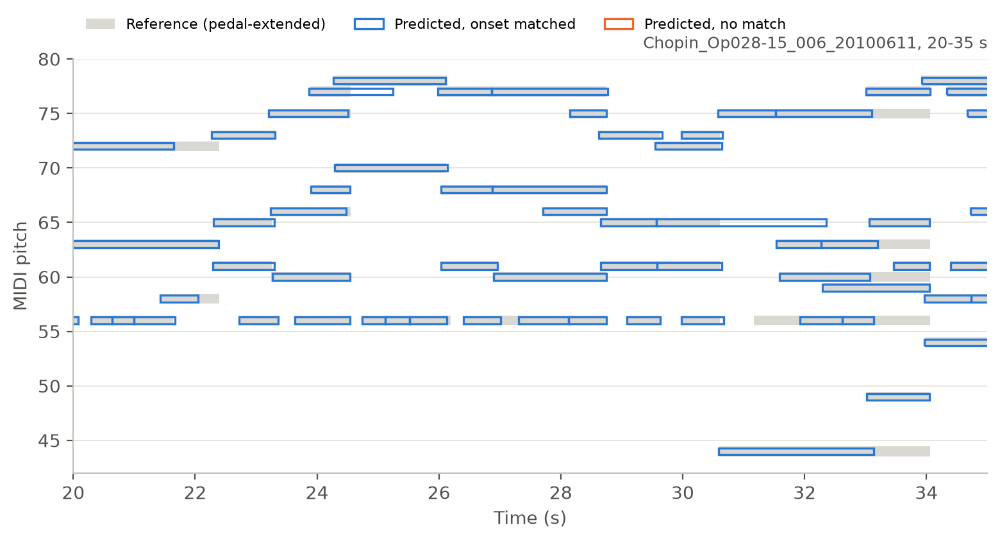
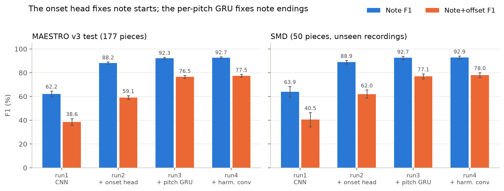
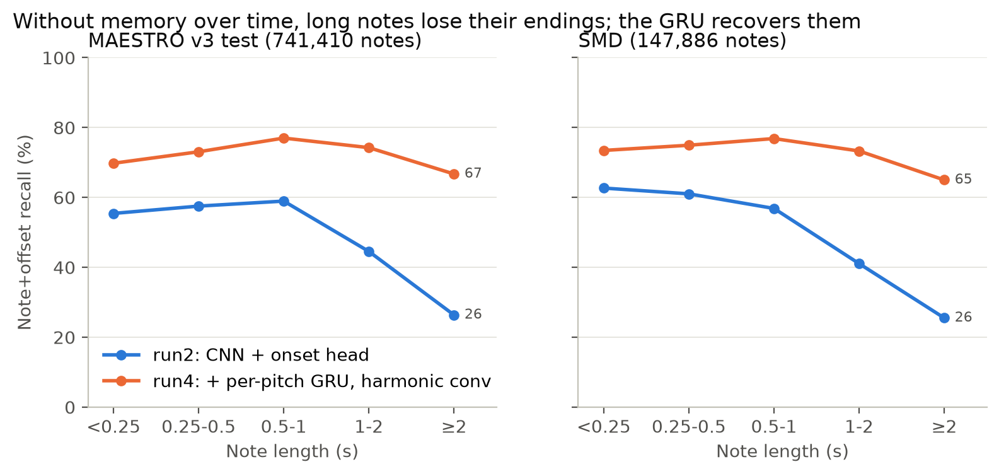
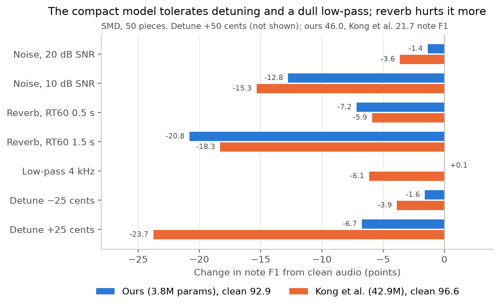

# Automated Music Transcription: compact piano audio-to-MIDI

A small, fast piano transcription model: log-CQT front end, a dilated CNN with
an onset head, and a per-pitch recurrent layer. It turns a piano recording into
a MIDI file at about 70x real time on a laptop CPU, with 3.8M parameters.

| Model | Params | MAESTRO v3 test (177 pieces)<br>frame / note / note+offset F1 | SMD (50 pieces, real audio, never used for training or tuning)<br>frame / note / note+offset F1 | CPU real-time factor |
|---|---|---|---|---|
| **This repo (run4)** | **3.8M** | 89.3 / 92.7 / 77.5 | 88.3 / 92.9 / 78.0 | **0.014** |
| Kong et al. 2021, released checkpoint | 42.9M (notes + pedal) | 90.9 / 96.8 / 84.7 | 90.2 / 96.6 / 83.4 | 0.302 |

All scores are F1 in %, averaged per piece, and every number in the table was
computed with this repo's evaluation code on the same pieces and labels.
Kong et al.'s checkpoint was trained on MAESTRO v2, whose test split has the same
performances as v3, so there is no train/test overlap. Under the original
protocol they report 96.8 note / 83.2 note+offset F1 (Toyama et al. 2023, Table 2).
Speed: 60 s of audio, Apple M3, 4 CPU threads.

**Findings**

1. **A per-pitch GRU fixes note endings.** The CNN alone sees +-240 ms of
   audio. Adding one small bidirectional GRU, shared by all 88 pitches, raises
   note+offset F1 from 59.1 to 76.5 on MAESTRO. The gain grows with note
   length, reaching +40 points on notes of 2 s or more, on both test sets.
2. **The compact model is more robust to detuning and dull recordings, less to
   reverb.** At +25 cents detuning its note F1 drops 6.7 points against 23.7
   for Kong et al.'s model; a 4 kHz low-pass does not affect it at all.
   Reverberation hurts it slightly more.
3. **About 21x faster than Kong et al.'s released checkpoint on a CPU, with
   11x fewer parameters, at 3.7 points lower note F1 on SMD.** Counting only
   Kong et al.'s note model (24.7M parameters, an estimated 59% of its run
   time), the speed-up is roughly 13x.

## Quick start

```bash
git clone https://github.com/gityag/Automated-Music-Transcription.git
cd Automated-Music-Transcription
pip install -e ".[train]"          # numpy, librosa, pretty_midi, mir_eval, torch, ...
```

Download the trained checkpoint (`run4_best.pt`) from the
[Releases page](https://github.com/gityag/Automated-Music-Transcription/releases)
into `models/`, then:

```bash
python scripts/transcribe.py my_piano.wav --ckpt models/run4_best.pt --out my_piano.mid
# only part of a long file:
python scripts/transcribe.py my_piano.mp3 --ckpt models/run4_best.pt --offset 30 --duration 20
```

Any format librosa can read works. Decoding thresholds default to the values
tuned on MAESTRO validation (frame 0.5, onset 0.9).

## How it works

**Input.** Audio is resampled to 16 kHz mono. The front end is a log-magnitude
constant-Q transform with 88 bins, one per piano key (A0 to C8, 12 bins per
octave), hop 256 samples (16 ms, 62.5 frames per second).

**Labels.** MIDI is parsed with pretty_midi. Note ends are extended while the
sustain pedal (CC64 >= 64) is held, but never past the next onset of the same
pitch, the same rule as Onsets and Frames. Duplicate notes are removed.

**Model** (`amt/models/cnn.py`, 3.80M parameters):

1. Four 3x3 convolutions over (frequency, time) with time dilations 1, 2, 4, 8
   (+-15 frames of context) and no frequency pooling.
2. A harmonic dilated convolution after the first layer (from HPPNet): each
   bin also sees the bins of its 2nd-8th harmonics, 12-36 bins above.
3. A fully connected layer over each frame's full (channels x 88) column, so
   every pitch can use all harmonics.
4. Frame and onset heads.
5. A residual per-pitch BiGRU (32 units per direction, weights shared by all
   88 pitches) that reads the CNN's logits and adds corrections through
   zero-initialised heads, so the model starts identical to the CNN alone.

**Training.** MAESTRO v3 official split (962 training pieces, 159.7 h).
Random 256-frame (4.1 s) windows, batch 16, 10 epochs of 8,770 steps, Adam
with learning rate 1e-3 and cosine decay to 5%, mixed precision. The onset loss
weights positives 10x and widens each onset target by +-1 frame. About 2.4 h on
one Kaggle T4 GPU.



**Decoding.** A note starts at a local maximum of the onset probability above
the onset threshold and ends where the frame probability falls below the frame
threshold; notes shorter than 3 frames are dropped.

## Results

### Ablation (MAESTRO v3 test, F1 %, 95% CI over pieces in brackets)

| Run | Change | Frame | Note | Note+offset |
|---|---|---|---|---|
| run1 | CNN, frame head only | 80.3 | 62.2 | 38.6 |
| run2 | + onset head | 78.4 | 88.2 | 59.1 |
| run3 | + per-pitch BiGRU | 89.2 | 92.3 | 76.5 |
| **run4** | **+ harmonic dilated conv** | **89.3** [88.8, 89.8] | **92.7** [92.0, 93.5] | **77.5** [76.3, 78.7] |
| run4, 20 epochs | train twice as long | 89.2 | 92.8 | 77.5 |



- Seed noise, measured by retraining run2 with another seed: +0.2 note F1 and
  +0.9 note+offset F1. The run3 gain is about 20x larger; the run4 gain over run3
  (+0.4 / +1.0) is within seed noise.
- Training for 20 epochs instead of 10 gives no gain: validation scores level
  off by about epoch 5.
- Thresholds are tuned on 24 MAESTRO validation pieces by note+offset F1. Tuning
  on onset F1 alone picks a frame threshold of 0.1 that raises note F1 slightly
  but cuts frame F1 by about 10 points.

### Where the errors are (note+offset recall, run2 -> run4)

| Note length | MAESTRO test (741k notes) | SMD (148k notes) |
|---|---|---|
| < 0.25 s | 0.554 -> 0.698 | 0.627 -> 0.735 |
| 0.25-0.5 s | 0.575 -> 0.731 | 0.610 -> 0.749 |
| 0.5-1 s | 0.590 -> 0.770 | 0.569 -> 0.769 |
| 1-2 s | 0.446 -> 0.743 | 0.411 -> 0.733 |
| >= 2 s | 0.264 -> 0.667 | 0.255 -> 0.650 |



- The length effect holds both for notes held by the sustain pedal (65% of SMD
  notes) and for notes without it. At equal length, the GRU removes most of
  the extra difficulty of pedal-sustained notes.
- Remaining errors grow with polyphony (note recall 0.93 with 1-2 sounding
  notes, 0.82 with 7 or more on MAESTRO) and are higher in the lowest octaves
  (both test sets) and the highest (MAESTRO).

### Robustness (SMD, note F1 %, change from clean in brackets)

| Condition | This repo (run4) | Kong et al. 2021 |
|---|---|---|
| Clean | 92.9 | 96.6 |
| White noise, 20 dB SNR | 91.5 (-1.4) | 93.0 (-3.6) |
| White noise, 10 dB SNR | 80.1 (-12.8) | 81.3 (-15.3) |
| Reverb, RT60 0.5 s | 85.7 (-7.2) | 90.7 (-5.9) |
| Reverb, RT60 1.5 s | 72.1 (-20.8) | 78.3 (-18.3) |
| Low-pass 4 kHz | 93.0 (+0.1) | 90.5 (-6.1) |
| Detune +25 cents | 86.2 (-6.7) | 72.9 (-23.7) |
| Detune -25 cents | 91.3 (-1.6) | 92.7 (-3.9) |
| Detune +50 cents | 46.0 | 21.7 |



The SMD recordings are about +7.5 cents sharp already (median over the 50
pieces), so "+25 cents" is about +32 cents from standard pitch and "-25" about
-17; this explains why detuning upwards hurts both models more.

## Reproducing

Data: [MAESTRO v3.0.0](https://magenta.tensorflow.org/datasets/maestro) and
[SMD](https://www.audiolabs-erlangen.de/resources/MIR/SMD) (piano
recordings with aligned MIDI). Features are cached once:

```bash
python scripts/cache_maestro_features.py --root /path/to/maestro-v3.0.0 --out data/processed/maestro
python scripts/cache_smd_features.py        # reads data/smd/, writes data/processed/smd/
```

Training (each run is one config; run4 = `configs/hd_gru.yaml`):

```bash
python scripts/train.py --cache data/processed/maestro --out runs/run4 --config configs/hd_gru.yaml --epochs 10
```

| Run | Config |
|---|---|
| run2 | `configs/onset.yaml` (seed repeat: `--seed 22`) |
| run3 | `configs/gru.yaml` |
| run4 | `configs/hd_gru.yaml` |

Evaluation and analysis:

```bash
# scores with thresholds tuned on validation, 95% CIs, per-piece results
python scripts/evaluate_model.py --ckpt runs/run4/best.pt --dir data/processed/maestro/test \
    --tune-dir data/processed/maestro/validation --out results/model_maestro_test_run4_ci.json
# paired bootstrap between two result files on the same pieces
python scripts/compare_runs.py results/model_smd_run3_ci.json results/model_smd_run4_ci.json
# recall by note length, register, polyphony and sustain pedal
python scripts/analyze_errors.py --dir data/processed/smd --midi-dir data/smd/midi \
    --ckpt run2=runs/run2/best.pt --ckpt run4=runs/run4/best.pt --out results/analysis_smd.json
# robustness and Kong et al. reference (needs SMD audio and piano_transcription_inference)
python scripts/robustness.py --audio-dir data/smd/wav_22050_mono --cache-dir data/processed/smd \
    --ckpt runs/run4/best.pt --out-dir results/robustness
python scripts/eval_kong.py --audio-dir data/smd/wav_22050_mono --cache-dir data/processed/smd \
    --out results/model_smd_kong_ci.json
# CPU speed
python scripts/benchmark_speed.py some_piece.wav --ckpt runs/run4/best.pt --seconds 60 --kong
```

Every number measured in this repo is stored as JSON in `results/`; the figures are
built from those files with `python scripts/make_figures.py --ckpt models/run4_best.pt`
(needs `pip install matplotlib`).

Tests: `pip install -e ".[train,dev]" && pytest` (model tests are skipped
without torch).

### Evaluation protocol

- Note metrics follow mir_eval: onset within 50 ms, offset within 20% of the
  reference duration or 50 ms, whichever is larger. Matching is done per pitch,
  which is exactly equivalent to mir_eval's global matching for pitches 100
  cents apart and much faster.
- References are the continuous, pedal-extended MIDI note times, not a
  frame-quantised roll.
- Scores are averaged per piece; 95% intervals come from 2,000 bootstrap
  resamples of pieces.
- The test sets are never used for any choice; thresholds and checkpoints are
  chosen on MAESTRO validation.
- Our code reproduces Kong et al.'s published SMD scores (96.6 vs 96.7 note F1,
  83.4 vs 83.3 note+offset F1), a check that the protocol matches the
  literature.

## Repository layout

```
amt/
  config.py            dataclass config, loaded from configs/*.yaml
  data/                MIDI parsing, pedal extension, feature caches, sampling
  features/cqt.py      log-CQT front end
  models/cnn.py        model (CNN, harmonic conv, per-pitch GRU), chunked inference
  training/loop.py     training loop, checkpoint selection, resuming
  evaluation/          decoding, metrics, bootstrap statistics, error analysis,
                       degradations, scoring of external systems
  inference.py         audio file -> notes -> MIDI
scripts/               caching, training, evaluation, analysis, transcription
configs/               one YAML per reported run
results/               every reported number, as JSON
tests/                 unit and end-to-end tests
```

## Limitations

- No velocity or pedal output: every note gets velocity 100.
- 12 bins per octave limit pitch resolution in the bass and above; a finer CQT
  would need re-computing all features.
- Single-seed results for run3 and run4; differences below about 1 point
  should not be read as significant.
- Trained only on MAESTRO (one piano type, concert recordings). Robustness was
  tested with synthetic degradations, not real phone recordings.

## References

- Hawthorne et al. (2018). Onsets and Frames: Dual-Objective Piano Transcription. ISMIR.
- Hawthorne et al. (2019). Enabling Factorized Piano Music Modeling and Generation with the MAESTRO Dataset. ICLR.
- Kong et al. (2021). High-resolution Piano Transcription with Pedals by Regressing Onset and Offset Times. IEEE/ACM TASLP.
- Wei et al. (2022). HPPNet: Modeling the Harmonic Structure and Pitch Invariance in Piano Transcription. ISMIR.
- Toyama et al. (2023). Automatic Piano Transcription with Hierarchical Frequency-Time Transformer. ISMIR.
- Edwards et al. (2024). A Data-Driven Analysis of Robust Automatic Piano Transcription.
- Kwon, Jeong, Nam (2024). Towards Efficient and Real-Time Piano Transcription Using Neural Autoregressive Models.
- Müller et al. (2011). Saarland Music Data (SMD). ISMIR late-breaking session.
